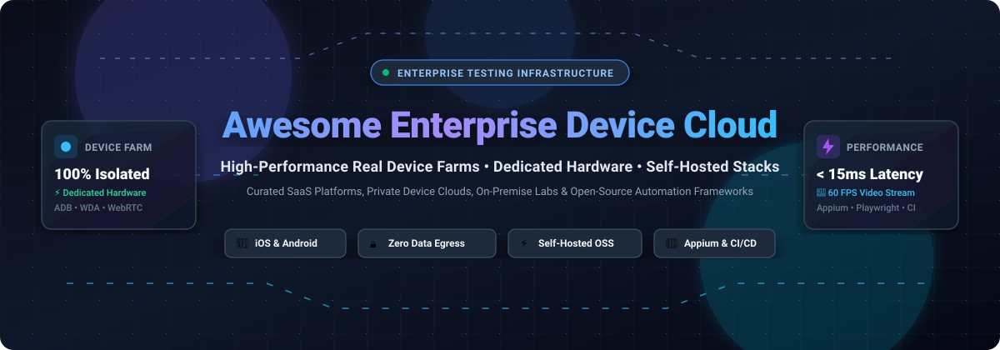

# 🚀 Awesome Enterprise High-Performance Device Cloud

  <b>A comprehensive curated catalog of Enterprise Real Device Cloud SaaS platforms, dedicated private testing labs, on-premise device farms, and self-hosted open-source mobile test infrastructure.</b>

Last updated: March 2026 • Curated for QA Architects, Mobile DevOps Engineers, and Enterprise Platform Teams

---

## 📖 Overview

Modern mobile application testing demands high execution concurrency, low streaming latency, and stringent enterprise security. This repository curates the leading **SaaS platforms** and **open-source frameworks** providing:

- 📱 **Real iOS & Android Devices**: Physical mobile phones and tablets under dedicated or isolated environments.
- 🔒 **Enterprise Isolation & Data Sovereignty**: Private networks, IPSec tunnels, MDM profiles, clean device sanitization, and zero-data-leakage architecture.
- ⚡ **High-Performance Execution**: Low-latency remote screen streaming (WebRTC/MJPEG up to 60 FPS), direct ADB/WDA access, and rapid parallel CI/CD automation.
- 🛠️ **Self-Hosted Open-Source Farms**: Fully private on-premise hardware orchestration without recurring per-device enterprise software licensing fees.

---

## 📑 Table of Contents

- [📊 Sector Overview & Market Dynamics](#-sector-overview--market-dynamics)
- [🏢 SaaS & Hosted Enterprise Platforms](#-saas--hosted-enterprise-platforms)
- [💻 Open-Source Device Farms & Automation Frameworks](#-open-source-device-farms--automation-frameworks)
- [🌟 Star History](#-star-history)
- [💖 Support](#-support)
- [🤝 How to Contribute](#-how-to-contribute)
- [⚠️ Disclaimer](#️-disclaimer)

---

## 📊 Sector Overview & Market Dynamics

The global cloud testing and mobile application testing market is valued between **$12B and $15B**, and is on track to surpass **$30B–$46B+** by 2034–2035 at an estimated Compound Annual Growth Rate (**CAGR**) of **13%–17%**. Key macro drivers include rapid smartphone/OS fragmentation, ubiquitous 5G network validations, audio/video streaming QoS requirements, and the imperative for high-frequency CI/CD build verification.

The sector displays a **moderately fragmented yet top-heavy structure**:
1. **Infrastructure & Testing Giants**: Hyper-scalers (AWS Device Farm) and dedicated multi-billion-dollar test suites (BrowserStack, SmartBear/BitBar, Perforce/Perfecto, Sauce Labs) command majority market share in large enterprises demanding SOC2 Type II, HIPAA, and private data center device allocations.
2. **Specialized & AI Challengers**: High-velocity challengers (LambdaTest, Kobiton, TestGrid, Corellium) compete aggressively on specialized virtualization, AI-driven autonomous test generation, self-healing scripts, and transparent pricing.
3. **Open-Source Self-Hosted Ecosystem**: Engineering teams seeking strict data sovereignty and predictable cost controls increasingly deploy self-hosted bare-metal clusters using open-source platforms like OpenSTF, GADS, baguette, and Sonic.

---

## 🏢 SaaS & Hosted Enterprise Platforms

> 📌 **Note:** Products are ordered by **Company Size (Valuation / Revenue Scale)** in descending order.

| Product | 🏢 Company Size (Valuation / Revenue) | 📝 Description | 💳 Starting Price | 🎁 Free Tier / Trial Limits |
|:---|:---|:---|:---|:---|
| **[AWS Device Farm Private Devices](https://aws.amazon.com/device-farm/)** | Market Cap: **$2.2T+** (Amazon) / AWS ARR: **$105B+** | Dedicated physical smartphones and tablets hosted in AWS data centers **exclusively for your organization**, supporting rooted Android configurations and custom network topologies. | **$200/device/month** (minimum monthly commitment) | **1,000 device minutes** one-time trial (public device pool) |
| **[BrowserStack Device Cloud Pro](https://www.browserstack.com/)** | Valuation: **$4.0B** / Revenue: **~$230M ARR** | Exclusive enterprise device pools with **fixed physical SIM cards, Apple Pay validation, biometric mockers, and AI test agents**. Custom Device Lab offers dedicated private racks. | Device Cloud Pro: **$249/parallel/month** (annual) | **30-day free trial** (30 min Live, 60 min Automate, 30 min App Live, 100 min App Automate) |
| **[BitBar Enterprise](https://smartbear.com/product/bitbar/pricing/)** (SmartBear) | Valuation: **~$1.9B** / Revenue: **~$150M–$200M ARR** | High-performance enterprise test cloud with **dedicated device clusters, private VPN tunnels, and zero test execution queues**. Native support for Appium, Selenium, and XCUITest. | Live Testing: **€45/parallel/month**; Unlimited: **€202/parallel/month** (annual) | **14-day free trial** with access to real Android and iOS devices (no credit card required) |
| **[Perfecto](https://www.perfecto.io/)** (Perforce) | Valuation: **~$2.0B+** / Perforce Revenue: **~$500M+** | Enterprise continuous testing platform featuring **dedicated clean-room devices, smart test failure analysis, and carrier network virtualization**. | Manual Testing: **$83/month**; Dedicated Private Cloud: Quote-only | **14-day free trial** (approx. 1,000 device minutes across web & real mobile devices) |
| **[LambdaTest](https://www.lambdatest.com/)** | Valuation: **~$400M** / Revenue: **~$120M ARR** | High-speed digital test cloud with **Real Device Cloud**, HyperExecute test orchestration engine, geolocated testing in 60+ countries, and private cloud deployments. | Real Device Live: **$49/month**; Real Device Automation: **$249/parallel/month** | **Free forever plan** (60 min/mo live browser testing; limited 1-min real device preview sessions) |
| **[Sauce Labs Enterprise Real Device Cloud](https://saucelabs.com/)** | Valuation: **~$300M+** (VC Funding: $272M) / Revenue: **~$85M–$95M ARR** | Scalable enterprise real device cloud with **private dedicated devices, Sauce Connect IPSec Proxy, and comprehensive crash reporting via Backtrace**. | Real Device Cloud: **$199/parallel/month** (annual) | **28-day free trial** (60 automated & live testing minutes, 3 parallel VMs) |
| **[Digital.ai Continuous Testing Pro](https://digital.ai/)** | Backed by TPG / Revenue: **~$140M ARR** | Enterprise real and virtual devices across **7 global Tier-3 data centers** (including Switzerland for strict GDPR/banking compliance). Features an MCP server for AI coding agents. | Starting estimate: **$250/device-slot/month**; Enterprise: Quote-only | **7-day trial** / Custom evaluation via guided POC (no permanent free tier) |
| **[Corellium](https://www.corellium.com/)** (Cellebrite) | Valuation: **$170M** (acquired by Cellebrite) / Revenue: **~$11M ARR** | **Hardware-virtualized Arm mobile devices** (Android, iOS) powered by a bare-metal type-1 hypervisor. Instant snapshotting, kernel-level inspection, and air-gapped on-premise server appliances. | Corellium Solo: **$3/device-hour**; Enterprise: from **$9,995/year** (~1,250 hrs/mo) | **30-day trial** on request (capped at ~100 core hours and 25 device slots) |
| **[Kobiton Enterprise](https://kobiton.com/)** | Total Funding: **$40M+** / Revenue: **~$27M ARR** | AI-driven mobile testing platform offering **self-healing Appium scripts, scriptless manual-to-automation conversion**, and flexible on-premise or hybrid device lab hosting. | Starting at **$83/month** (unlimited users, entry tier) | **30-day free trial** (includes 300 testing minutes on real cloud devices) |
| **[HeadSpin](https://www.headspin.io/)** | Valuation: **$28.2M** (acquired by PartnerOne) / Revenue: **~$21M ARR** | Global device infrastructure deployed across 50+ telecom networks with dedicated RF-isolated appliances for real-world audio, video, and biometric performance benchmarks. | CloudTest Lite: **$49/month** (or $39/mo annual); CloudTest Go: **$100/device/month** | **Sales demo & guided pilot evaluation** (no self-service free tier) |
| **[TestGrid Dedicated Cloud](https://testgrid.io/pricing)** | Pre-Series A / Revenue: **~$5.3M ARR** | **Turnkey private test lab deployed on-premise or in your VPC**. Features real mobile devices, Virtual USB debugging, no data egress, and unmetered parallel test runs. | CoTester Starter: **$199/seat/month**; Dedicated Private Infra: Quote-only | **Free forever plan** (200 minutes/month, 2 minutes max per session, 1 concurrent device) |

---

## 💻 Open-Source Device Farms & Automation Frameworks

> 📌 **Note:** Repositories are ordered by **GitHub Stars_Count** descending. Stars_Badges link directly to each project's stargazers page.

| Project | ⭐ GitHub_Stars | 📝 Architectural Description |
|:---|:---|:---|
| **[OpenSTF (stf)](https://github.com/openstf/stf)** |  | **The foundational open-source Android device farm platform.** Control physical Android devices from any browser with real-time screen streaming (minicap), remote touch/gestures (minitouch), app deployment, and remote ADB debugging over TCP/IP. |
| **[Airtest](https://github.com/AirtestProject/Airtest)** |  | **Cross-platform UI automation framework** by NetEase for Android, iOS, and Windows. Utilizes computer vision and OCR to automate testing across multi-device farms without requiring source code modification. |
| **[fb-idb](https://github.com/facebook/idb)** |  | **iOS Development Bridge (idb) by Meta.** A high-performance CLI and Python/gRPC service for automating iOS Simulators and real iOS hardware across networked machines, enabling scalable Mac-based device farms. |
| **[DeviceFarmer/stf](https://github.com/DeviceFarmer/stf)** |  | **Actively maintained community successor to STF.** Incorporates modern Node.js runtimes, streamlined Docker Compose deployments, enhanced ADB reconnection stability, and expanded support for modern Android versions (Android 11–15+). |
| **[Macaca](https://github.com/alibaba/macaca)** |  | **Alibaba's enterprise-grade multi-platform test automation solution.** Features a lightweight, modular client-server architecture capable of driving real Android and iOS device clusters across private infrastructure. |
| **[go-ios](https://github.com/danielpaulus/go-ios)** |  | **Native Go toolchain for communicating with physical iOS devices without a Mac.** Run Appium, install IPAs, capture syslog, and stream device video directly from Linux and Windows server racks, drastically reducing device farm host costs. |
| **[baguette](https://github.com/tddworks/baguette)** |  | **Headless simulator control & multi-device farm for Apple Simulators.** Streams crisp 60 FPS video, translates multi-finger gestures, and provisions dozens of virtual iOS devices simultaneously on bare-metal Apple Silicon hosts. |
| **[Sonic](https://github.com/SonicCloudOrg/sonic-server)** |  | **Modern enterprise distributed mobile test platform.** Manages both iOS and Android physical devices with Web/Appium test automation, real-time remote control projection, agent-hub distributed clustering, and visual telemetry dashboards. |
| **[Appium Device Farm](https://github.com/AppiumTestDistribution/appium-device-farm)** |  | **Official Appium 2.0 dynamic session allocation plugin.** Intelligently routes incoming test executions to available physical devices and simulators across networked nodes, serving as a lean self-hosted device management layer. |
| **[GADS](https://github.com/shamanec/GADS)** |  | **Modern self-hosted device farm for iOS and Android.** Built in Go with WebRTC/MJPEG streaming, automated provisioning, device reservation scheduler, Smart TV support (LG WebOS, Samsung Tizen), and direct Selenium Grid 4 node registration. |
| **[MCloud](https://github.com/zebrunner/mcloud)** |  | **Dockerized mobile cloud infrastructure by Zebrunner.** Orchestrates connected Android and iOS devices, Appium drivers, and video recorders into a unified containerized cluster for automated testing pipelines. |
| **[GADS-devices-provider](https://github.com/shamanec/GADS-devices-provider)** |  | **Device provider worker for GADS.** Configures and monitors USB-attached iOS and Android devices, handling local video capture pipelines and exposing endpoints to the central GADS hub. |
| **[tapflow](https://www.npmjs.com/package/tapflow/v/0.2.0)** | — | **Lightweight self-hosted iOS Simulator & Android Emulator farm.** Turn an existing Mac workstation into a private team test farm with zero firewall setup, 30 FPS browser-based interactive streaming, and session replay recordings. |

---

## 🌟 Star History

---

## 💖 Support

Thank you for visiting and using this resource! If you find this curated ecosystem helpful for your engineering workflow or organization, please consider supporting the project:

- ⭐ **Star this repository** to help others discover it.
- 🍴 **Fork and contribute** by submitting new platforms, tools, or corrections.
- 📢 **Share with colleagues** across testing, DevOps, and mobile architecture communities.
- ☕ **Buy me a coffee / Sponsor the project**: Support continued research and open-source curation via the [GitHub Sponsors Dashboard](https://github.com/sponsors/ishandutta2007).

---

## 🤝 How to Contribute

Contributions are always welcome! Help keep this curated list accurate and comprehensive:

1. **Fork** the repository.
2. Create a new feature branch (`git checkout -b add-device-cloud-tool`).
3. Add or update entries in `README.md` following the established table structure.
4. Ensure descriptions are objective, include verified pricing / free tier limits (for SaaS), and include stargazers links (for open-source).
5. Open a **Pull Request** with a brief summary of additions or updates.

---

## ⚠️ Disclaimer

- This is an independent **community-curated** reference list — inclusion does not imply official endorsement or sponsorship.
- Dedicated enterprise device clouds grant deep device-level access and potential connectivity to internal infrastructure via tunnels; organizations must enforce strict device reset policies, MDM isolation profiles, and credential sanitization between test executions.
- **Enterprise pricing is subject to vendor negotiation**: baseline starting prices reflect publicly documented plans; multi-device fleets, custom dedicated racks, and private SLAs are quoted individually by vendors.

---

  Built with ❤️ for mobile QA engineers, platform architects, and infrastructure teams worldwide.

